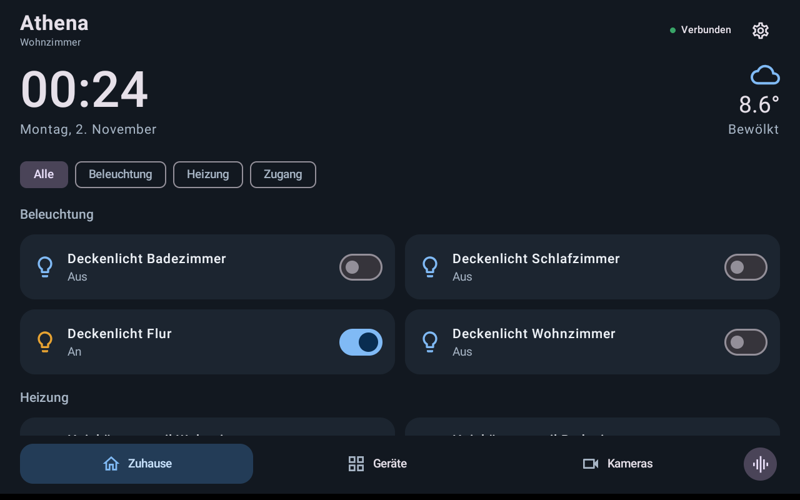
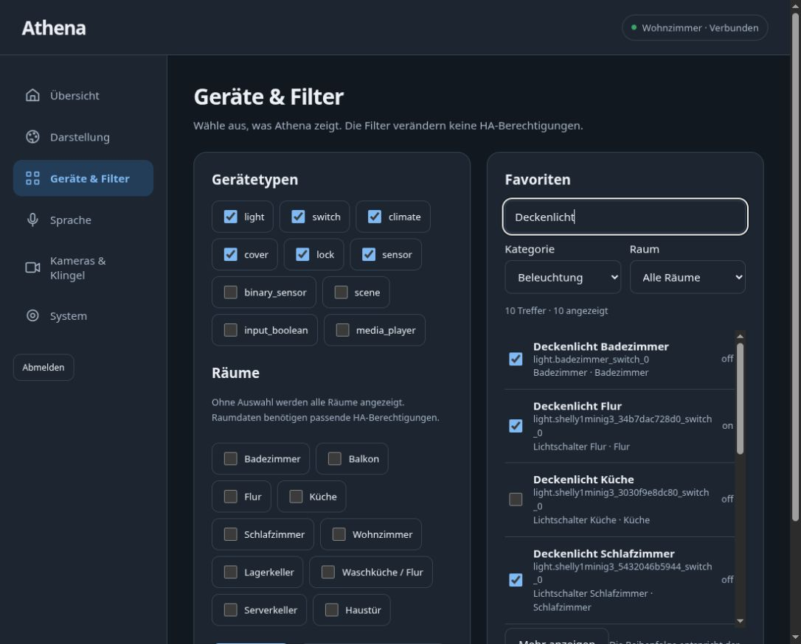
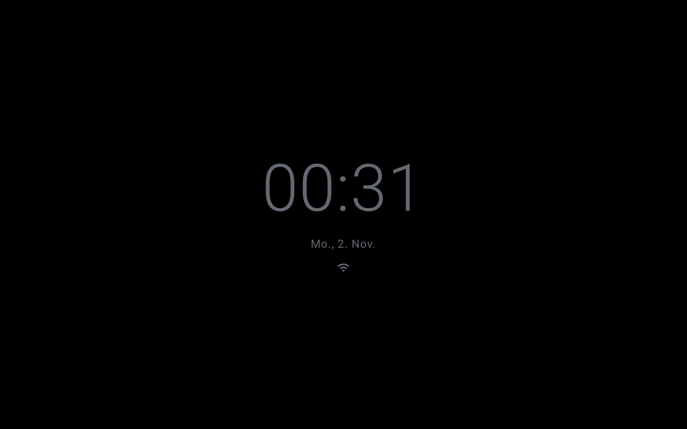

# Athena

**Home-Assistant-Anzeige für gerootete Echo-Show-Geräte. Frühe experimentelle Testversion.**

**Deutsch** · [English](README.md) · [Installation](docs/install.de.md) · [Root-Anleitung](docs/root.de.md)

Athena ist eine Android-App mit eigener Web-Konfiguration. Die Anzeige verbindet sich direkt mit Home Assistant. **echo-dot-assist** übernimmt Mikrofone, Aktivierungswort und Sprachantworten. Die Sprache wird über die ESPHome-Integration angebunden. Athena stellt die Oberfläche und die lokalen Einstellungen bereit.

Aktuell geprüft: **Echo Show 8, 2. Generation (2021), A8H3N2 / athena, Firmware PS75741.7080N**. Andere Modelle sind bisher nicht unterstützt. 





## Funktionen

- Lokale Wecker mit einmaliger oder wochentäglicher Wiederholung, Schlummern und Nachtmodus-Unterbrechung. Optionale HA-Synchronisierung mit gespeicherter Warteschlange und Gerätebestätigung; Sprachsteuerung über Assist. [Wecker einrichten](docs/alarms.de.md).

- Nachtansicht mit schwarzem Hintergrund und Uhr, automatischem Lichtsensor-Modus, einstellbarer Helligkeit, Lichtschwelle und Verzögerung. Datum/Statussymbole sind optional. Tippen öffnet vorübergehend die normale Ansicht; Sprache und Klingeln können sie überlagern.
- Uhr, Datum, HA-Wetter und Favoriten. Optionale Gruppierung nach Raum und Kategorie.
- Friendly Names als Hauptanzeige, Entitäts-IDs darunter. Suche nach Name, ID, Gerät und Raum; zusätzliche Kategorie-/Raumfilter und seitenweises Nachladen im Browser.
- Licht, Schalter, Rollläden, Szenen und Thermostat-Sollwerte bedienen. Weitere Entitäten als Status anzeigen.
- Helles/dunkles Theme und austauschbare Sprachvisualisierungen. Automatische Anzeige des echten lokalen Sprachzustands.
- Kameraansicht über HLS, sofern unterstützt, sonst aktualisierte Einzelbilder. Einstellbarer Klingelauslöser, Anzeigedauer und lokaler Klingelton.
- WebUI unter `http://ECHO-IP:26804`, gekoppelt mit vierstelligem Einmalcode am Echo.
- Deutsche/englische Übersetzungskataloge. Optionaler Autostart. HA-Zugangsdaten werden verschlüsselt gespeichert und nicht exportiert.

## Installation

[Download v0.4.0-alpha.1](https://github.com/gerrit117/Athena/releases/tag/v0.4.0-alpha.1)

Root und der geprüfte echo-dot-assist-Unterbau sind vorhanden:

```sh
python3 scripts/install.py --apk /pfad/zur/Athena.apk --check
python3 scripts/install.py --apk /pfad/zur/Athena.apk
```

Das Skript prüft Gerät, Firmware und Audiodienst. Es entsperrt keinen Bootloader, flasht keine Firmware und löscht keine Nutzerdaten. `--app-only` lässt den Audiodienst unverändert. Die [vollständige Anleitung](docs/install.de.md) erklärt auch die direkte ESPHome-Sprachverbindung über Port **26053**.

Noch originales Fire OS? Mit der [Root-Anleitung](docs/root.de.md) beginnen. Dort stehen Hardware, Originaldownloads, vollständige Prüfsummen und die geprüfte Reihenfolge. Firmware, Unlocker und Root-Pakete werden nicht mitgeliefert.


## Aktuelle Grenzen

- Der vollständige Root-/Audioaufbau ist für Linux und die genannte Hardware/Firmware beschrieben.
- Autostart öffnet Athena nach dem Gerätestart. Kameraunterstützung hängt vom HA-Streamformat ab. WebRTC und Gegensprechen fehlen.
- Sprachstatus derzeit ohne Mikrofonpegel und Transkript. Theme-Paketinstallation ist noch nicht implementiert.
- Die Status-Erweiterung ist an den geprüften Audiobuild gebunden. Fremde Builds/Overrides werden nicht überschrieben.
- Bisherige Test-APKs nutzen einen lokalen Debug-Schlüssel. Ein späterer Signaturwechsel benötigt eine Umstellungsanleitung.
- Die optionale Weckerintegration benötigt HA 2026.11 und einen passenden Gesprächsagenten. AirPlay-2- und Google-Cast-Empfang sowie die eingebaute Echo-Kamera sind noch nicht enthalten.

## Verwendete Projekte

| Projekt | Beitrag |
|---|---|
| [Gamer92000/echo-dot-assist](https://github.com/Gamer92000/echo-dot-assist) | Echo-Audio, Aktivierungswort, ESPHome-kompatible Sprachübertragung und Einrichtung. Geprüfter Stand `1c00727d332c3b0ee4d13b59f702c78839431694`. |
| [saiyaku-athena auf XDA](https://xdaforums.com/t/unlock-root-twrp-unbrick-amazon-echo-show-8-2nd-gen-2021-athena.4804958/) | Bootloader-Unlock, Recovery und Root. |
| [baileyboy0304/ES8_Athena](https://github.com/baileyboy0304/ES8_Athena) | Geräteeinrichtung und Firmwareprüfung. |
| [baileyboy0304/VACAV](https://github.com/baileyboy0304/VACAV) | Grundlagen der Echo-Anzeige und Audioanbindung. |
| [MSP1974/ViewAssistCompanionApp](https://github.com/MSP1974/ViewAssistCompanionApp) | Android-Display-App. |
| [dinki/View-Assist](https://github.com/dinki/View-Assist), [View-Assist-Integration](https://github.com/dinki/view_assist_integration) | Anzeigekonzepte und Home-Assistant-Integration. |
| [TargetCrafter/HA-Alarmclock](https://github.com/TargetCrafter/HA-Alarmclock) | Grundlage der mitgelieferten HA-Weckerintegration; um gespeicherte Befehle, Bestätigungen und Assist-Werkzeuge erweitert. GPL-3.0. |
| [Home Assistant](https://github.com/home-assistant/core) | Entitäts-APIs, ESPHome und Assist-Pipeline. |

Patch und MIT-Lizenzhinweis des Audiounterbaus liegen unter [bridge/](bridge/). Das ursprüngliche Systemprogramm bleibt erhalten. Die Projekte sind eigenständig; ihre Erwähnung bedeutet nicht, dass deren Autoren Athena betreuen.

## Selbst bauen

JDK 21, Android SDK 35, Build Tools 35.0.0, Gradle 8.11.1 und Node.js/npm:

```sh
cd web
npm ci
npm run build
cd ..
./gradlew :app:assembleDebug :app:testDebugUnitTest :app:lintDebug
python3 -m unittest discover -s tests -v
```

`ANDROID_HOME` oder lokale, nicht versionierte `local.properties` setzen. APK: `app/build/outputs/apk/debug/app-debug.apk`. Target API 28 ist für Fire OS 7 beabsichtigt; kein Play-Store-Build. Android-App: Kotlin/Compose/Media3. WebUI: lokale TypeScript-/HTML-/CSS-Dateien. Siehe [Architektur](docs/architecture.md).

## Lizenzen

Athena-App und eigenständiger Protokollclient: MIT. Die abgeleitete HA-Weckerintegration: [GPL-3.0](custom_components/ha_alarmclock/LICENSE), mit [Herkunftshinweis](custom_components/ha_alarmclock/NOTICE.md). Audiounterbau: eigene Hinweise in [bridge/NOTICE.md](bridge/NOTICE.md).
