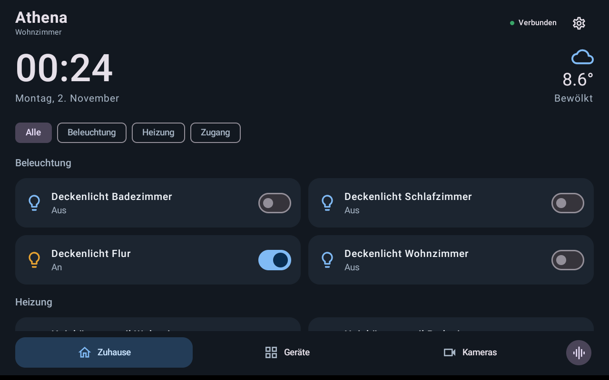
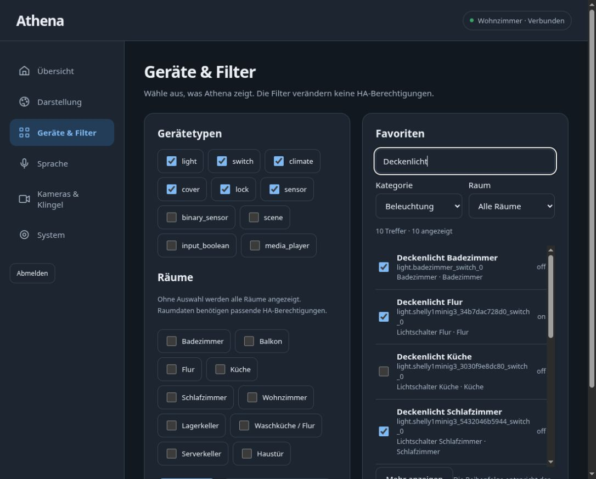
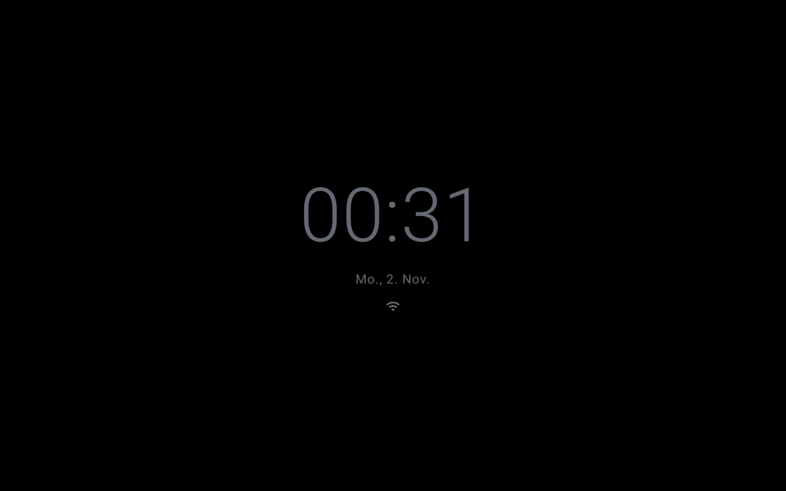

# Athena

**Home Assistant display for rooted Echo Show devices. Early experimental test version.**

[Deutsch](README.de.md) · **English** · [Installation](docs/install.en.md) · [Root guide](docs/root.en.md)

Athena is an Android display app with local web configuration. It connects directly to Home Assistant and uses **echo-dot-assist** for microphones, wake words and spoken replies. The direct setup needs no Lovelace dashboard, View Assist, VACAV or Music Assistant.

Tested hardware: **Echo Show 8, 2nd generation (2021), A8H3N2 / athena, firmware PS75741.7080N**. Other models are not currently supported. This is an early preview, not a finished appliance image.





## Features

- Sensor-based night view with a black clock screen, adjustable brightness, threshold and delay. Optional date/status icons; tap to reveal the main view temporarily. Voice and doorbell events can interrupt it.
- Clock, date, HA weather and configurable favorites. Optional room and category groups.
- Friendly names and secondary entity IDs. Search by name, ID, device and room, with category/room filters and paged web results.
- Controls for lights, switches, covers, scenes and thermostat setpoints. Other entities can show status.
- Light/dark themes and interchangeable voice visualizations. Automatic display follows actual local listening, processing and speaking states.
- Camera view using HLS where supported, with refreshed snapshots as a fallback. Configurable doorbell trigger, camera duration and local ringtone.
- WebUI at `http://ECHO-IP:26804`, paired through a four-digit one-time code generated on the Echo.
- German and English catalogs for app and WebUI. Optional autostart. Encrypted HA credentials, omitted from exports.

## Install

Already rooted, with the reviewed echo-dot-assist audio build installed:

```sh
python3 scripts/install.py --apk /path/to/Athena.apk --check
python3 scripts/install.py --apk /path/to/Athena.apk
```

The installer checks device, firmware and audio binary. It never unlocks, flashes firmware or wipes data. `--app-only` keeps audio unchanged. The [full installation guide](docs/install.en.md) includes direct ESPHome voice on port **26053**.

Starting with stock Fire OS? Follow the [root guide](docs/root.en.md) first. Hardware requirements, original downloads, checksums and the tested sequence are listed there. Firmware and third-party unlock/root archives are not bundled.

Existing VACAV setup? Follow the [migration guide](docs/migration.en.md). Only one integration may own the Echo's voice connection.

## Current limits

- Complete root/audio setup is documented for Linux and the hardware/firmware above.
- Direct ESPHome adoption and pipeline selection work on the test device. A subsequent voice request encountered a known HTTP 400 problem in the test HA pipeline; a complete successful reply after migration remains unconfirmed.
- Standalone autostart has passed a full reboot test with VACAV disabled. Camera support depends on HA's stream format. No WebRTC or two-way talk yet.
- Voice status has no microphone level or transcript. Theme package installation is not implemented.
- The included status binary is pinned to the reviewed audio build. Unknown builds and custom overrides are not overwritten.
- Existing test APKs use a local debug signing key. A future key change needs migration instructions.
- Alarm voice commands and optional media receivers are work in progress, not working release features.

## Credits

| Project | Used for |
|---|---|
| [Gamer92000/echo-dot-assist](https://github.com/Gamer92000/echo-dot-assist) | Echo audio, wake words, ESPHome-compatible voice and device setup. Reviewed revision `1c00727d332c3b0ee4d13b59f702c78839431694`. |
| [saiyaku-athena, XDA](https://xdaforums.com/t/unlock-root-twrp-unbrick-amazon-echo-show-8-2nd-gen-2021-athena.4804958/) | Bootloader unlock, recovery and root. |
| [baileyboy0304/ES8_Athena](https://github.com/baileyboy0304/ES8_Athena) | Earlier installation, firmware checks and display setup knowledge. |
| [baileyboy0304/VACAV](https://github.com/baileyboy0304/VACAV) | Previous combined display/voice setup and migration knowledge. |
| [MSP1974/ViewAssistCompanionApp](https://github.com/MSP1974/ViewAssistCompanionApp) | Previous Android display companion work. |
| [dinki/View-Assist](https://github.com/dinki/View-Assist), [View Assist integration](https://github.com/dinki/view_assist_integration) | Earlier dashboard/display concept and integration. |
| [Home Assistant](https://github.com/home-assistant/core) | Entity APIs, ESPHome integration and Assist pipeline. |

The audio status patch and upstream MIT notice are in [bridge/](bridge/). The original system binary is retained. The projects above are independent; credit does not mean they maintain or endorse Athena.

## Build

JDK 21, Android SDK 35, Build Tools 35.0.0, Gradle 8.11.1 and Node.js/npm:

```sh
cd web
npm ci
npm run build
cd ..
./gradlew :app:assembleDebug :app:testDebugUnitTest :app:lintDebug
python3 -m unittest discover -s tests -v
```

Set `ANDROID_HOME` or an untracked `local.properties`. APK: `app/build/outputs/apk/debug/app-debug.apk`. Target API 28 is intentional for Fire OS 7; this is not a Play Store build. Android uses Kotlin/Compose/Media3; the WebUI uses local TypeScript/HTML/CSS assets. See [architecture](docs/architecture.md).
